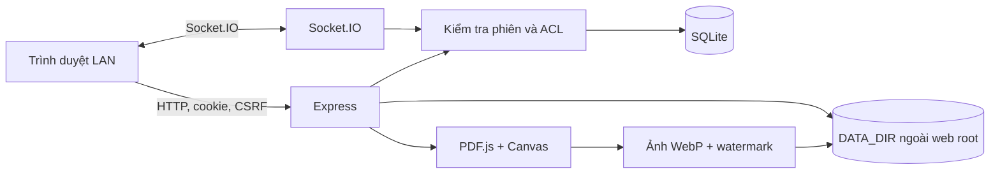

# Kiến trúc hệ thống

Express phục vụ HTML/CSS/JS nội bộ, REST API, xác thực và chuyển tài liệu. SQLite lưu tài khoản, phân quyền cuộc họp, trạng thái trình chiếu, biểu quyết và nhật ký. Socket.IO chỉ phát trạng thái đã được máy chủ kiểm tra; mọi sự kiện điều khiển xác thực lại phiên, thành viên và vai trò. Dữ liệu hoạt động nằm trong `DATA_DIR`, tách khỏi thư mục công khai.

## Luồng tài liệu

Thư ký tải PDF lên. Máy chủ xác thực loại/kích thước, lưu bản gốc dưới `DATA_DIR`, dựng ảnh trang bằng PDF.js/canvas, rồi tạo ảnh WebP gắn watermark theo người xem. API ảnh kiểm tra ACL mỗi lần và trả `no-store`; API không phân phối bản PDF gốc cho đại biểu. LibreOffice headless được dùng để chuyển Office nếu có cài trên máy chủ.

## Mô hình dữ liệu

`users` và `audit_logs` dùng chung toàn hệ thống. `meetings`, `meeting_participants`, `agenda_items`, `attendance`, `documents`, `document_pages`, `document_access` và `personal_notes` thuộc từng cuộc họp/tài liệu. `meeting_state` và `speech_history` lưu tiến trình phòng họp. `polls`/`poll_options` định nghĩa biểu quyết; `public_votes` gắn danh tính và phương án, còn `secret_vote_ledger` tách khỏi `secret_ballots`. `meeting_minutes` lưu phần biên bản thư ký.

Ứng dụng là nguyên mẫu chạy trong mạng nội bộ. Chứng thư HTTPS, dịch vụ nền, đo kiểm phần cứng thật và đóng gói các nền tảng đích cần được hoàn thiện trước khi triển khai sản xuất.
